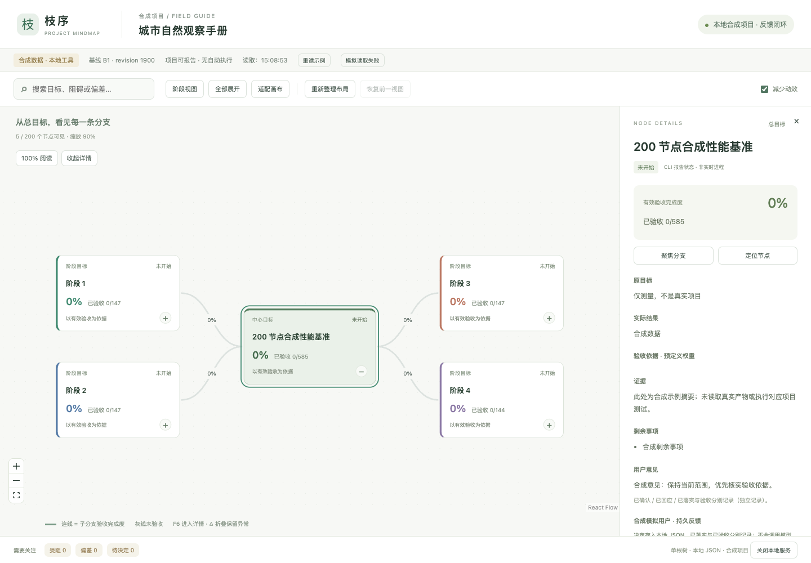

# Progress Map — archived project

This public repository preserves the local Progress Map project at the Owner’s request on 2026-10-14. The Owner found the product unsatisfactory and requested closeout. **The product did not pass final user acceptance; the total plan was not completed.** No further work is authorized by this archive.

The local application represented project plans, progress evidence, and acceptance decisions in an interactive map. The archived source includes a separate synthetic demonstration, controlled recovery procedures, and records of the stages that were tested.

## Historical demonstration

This repository image shows an earlier synthetic benchmark at its initial view. The visible progress values belong to the fixture. See the [historical performance record](phase-one-mindmap/PERFORMANCE.md) for test context and the [final self-test report](phase-one-mindmap/FINAL_SELF_TEST_V07.md) for later validation scope.

## Browse the archive

- [Source and operating notes](phase-one-mindmap/README.md)
- [Final acceptance scope](phase-one-mindmap/FINAL_ACCEPTANCE_SCOPE_V07.md)
- [Controlled recovery and maintenance](phase-one-mindmap/MAINTENANCE.md)

Program source and its existing documentation are under `phase-one-mindmap/`. The complete project-material archive is attached to Release `archive-2026-10-14`: it includes project state, original acceptance records, evidence, screenshots, stage plans/reviews, backup/export packages, historical artifacts, and closeout records. These data are excluded from normal source Git tracking but included in that Release archive.

The archive excludes only Git internals, dependency directories (`node_modules`), the agent navigation cache, and macOS `.DS_Store` metadata. Dependencies can be restored using the included package manifest and lockfile. Compiled assets and business records are preserved in the archive. It is a material backup, not a public deployment.

The final running product version was `sha256-1afc6fa4135db55393436ad0565d3f283f96fb94ada2b022009999b3bc509da6`; business revision 223, baseline B4. Original 16 user decisions and the old 12/new 3 undecided conditions remain unchanged. P4 final independent on-screen observation and final human receiving were not completed.

Before local cleanup, the owned local service was stopped. Release downloads must be checked against `ARCHIVE_MANIFEST.json` and the archive SHA256 before recovery. The business binding records the original canonical root: restore to that path or use the existing controlled clone/recovery workflow described in `phase-one-mindmap/MAINTENANCE.md`; do not alter integrity, identity, or recovery epoch manually.
